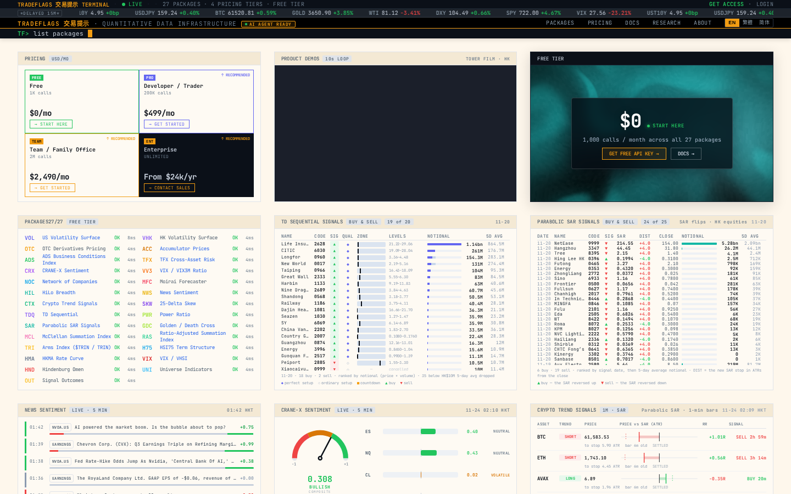
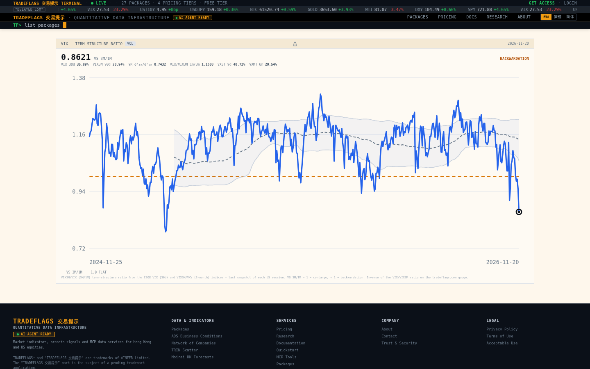
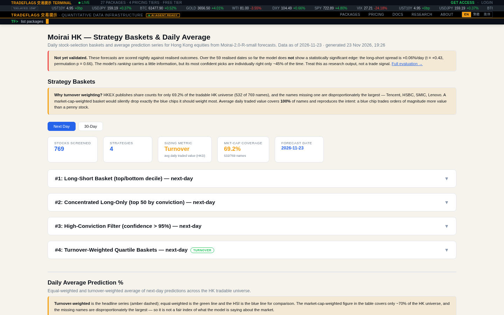
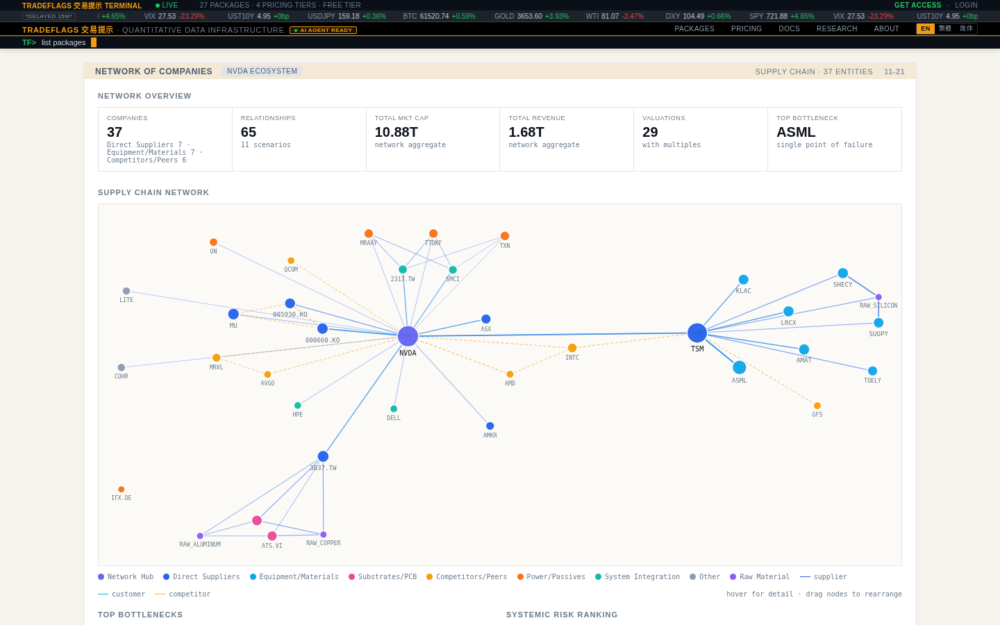
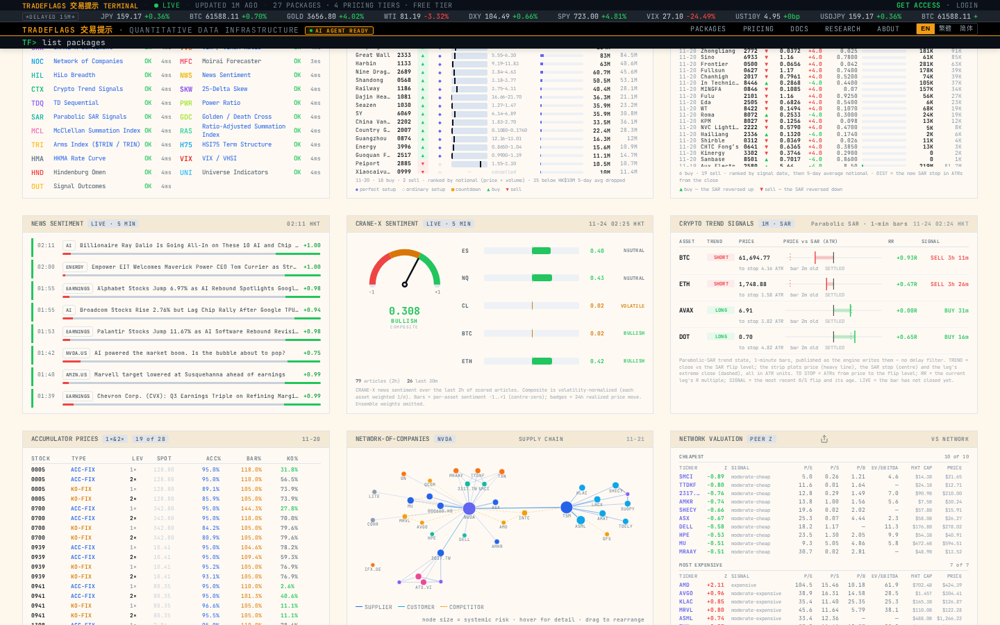

# TradeFlags — HK stocks & US stocks: Breadth, Volatility & Accumulator Pricing

[](https://glama.ai/mcp/connectors/com.tradeflags.api/trade-flags-mcp)

Read-only market data for Hong Kong and US equities, delivered over the Model
Context Protocol — one streamable-HTTP endpoint, installable in Claude Code,
Hermes, ChatGPT, Cursor, and any MCP-capable agent. Every response is
timestamped; every tool states its units and the session it describes.

**Operator:** AINFER Limited · Hong Kong · Business Registration No. 81518145

## What you see

| | |
|:---:|:---:|
|  |  |
| *The dashboard — breadth, volatility, sentiment and network panels, one per series.* | *VIX/VIX3M ratio with the 100-day mean and ±1σ bands.* |
|  |  |
| *Moirai-2.0-R-small forecasts — strategy baskets and daily average.* | *The supply-chain network model: nodes, edges and shock scenarios.* |

## AI forecasting — Moirai (live model)

A Moirai-2.0-R-small time-series model runs on a schedule and publishes daily
distribution forecasts for the Hong Kong index — direction, P(Up), confidence
and a ±1σ band (equal- and cap-weighted) — plus a stock-selection basket.
Every forecast is scored nightly against realised outcomes, and the cumulative
track record ships with the forecast. This is a live, scored model, not a
demo.



## What it serves

37 tools across the catalogue, all read-only, idempotent and timestamped:

- **Breadth & signals** — TRIN/Arms Index, McClellan, RASI, Hi-Lo, power ratio, TD Sequential, Parabolic SAR, Hindenburg Omen, signal outcomes.
- **Volatility** — SVI-fitted volatility surfaces (index and per-stock), term structure, 25Δ skew, VHSI/VIX levels.
- **Macro & sentiment** — ADS Business Conditions Index, CRANE-X sentiment, VIX term structure, HKMA curve.
- **AI forecasting** — Moirai-2.0-R-small time-series model, live and nightly-scored: HK index distribution forecasts, P(Up), confidence, ±1σ band, and stock-selection baskets.
- **Company network** — nodes, edges, and what-if shock scenarios.
- **On-demand pricing** — accumulator and OTC equity-derivative pricing with NPV and Greeks, computed live.

See [docs/tools.md](docs/tools.md) for the full catalogue.

## Connect

One endpoint — streamable HTTP:

```
https://api.tradeflags.com/mcp
```

### Claude Code

```
claude mcp add tradeflags --transport http --url https://api.tradeflags.com/mcp --header "Authorization: Bearer ***"
```

or via `.mcp.json`:

```json
{
  "mcpServers": {
    "tradeflags": {
      "type": "http",
      "url": "https://api.tradeflags.com/mcp",
      "headers": { "Authorization": "Bearer tf_live_YOUR_KEY" }
    }
  }
}
```

### Hermes

In `~/.hermes/config.yaml`:

```yaml
mcp_servers:
  tradeflags:
    url: "https://api.tradeflags.com/mcp"
    headers:
      Authorization: "Bearer tf_live_YOUR_KEY"
```

### ChatGPT / Claude Desktop (OAuth)

Their "Connect" flow uses the RFC 9728 discovery endpoints and signs you in
with Google/Apple/email — no API key needed:

- `https://api.tradeflags.com/.well-known/oauth-protected-resource`
- `https://api.tradeflags.com/.well-known/oauth-authorization-server`

Full install guide: [docs/install.md](docs/install.md)

## Worked example

Ask your agent:

> Price a ko_fixed accumulator on 0700 at 2.0x leverage.

The tool solves the structure to net-zero NPV and returns spot, accrual level,
knock-out barrier, NPV and the Greeks. Use `otc_pricing__price` when you want
to pin the strike, barrier and base level yourself instead of letting the
solver pick them.

## Get an API key

Sign in at [tradeflags.com](https://tradeflags.com), open your account
dashboard, and issue a key.

| Plan | Quota |
|---|---|
| Free | 1,000 calls / month |
| Pro | 200,000 calls / month |
| Team | 2,000,000 calls / month |
| Enterprise | custom |

Pricing: [tradeflags.com/pricing.php](https://tradeflags.com/pricing.php)

## Why TradeFlags

- **One tool per series.** Every tool's description states its units and the session it describes, so an agent knows what it is getting without a schema lookup.
- **Validation travels with the number.** A model output that has been checked against realised outcomes carries that status; nothing is presented as a research claim without it.
- **Read-only and timestamped.** No orders or account actions, and every response carries an `as_of` so staleness is detectable.

## Registry manifests

- `server.json` — official MCP Registry manifest (namespace `com.tradeflags.api`).
- `smithery.yaml` — Smithery config schema.

## Documentation

- [tradeflags.com/docs](https://tradeflags.com/docs) — full documentation.
- [Trust & security](https://tradeflags.com/trust.php) — data provenance, security, availability, compliance.

## Disclaimer

Outputs are computational audit data only. Not investment advice. No dealing,
advising or asset-management activity is conducted.
